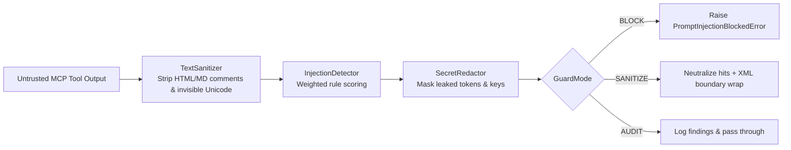

# mcp-prompt-guard

**English** | [简体中文](README_CN.md)

[](https://github.com/huotianyyy/mcp-prompt-guard/actions/workflows/ci.yml)
[](https://www.python.org/downloads/)
[](LICENSE)

Zero-dependency Python middleware for defending **Model Context Protocol (MCP)** servers and AI coding agents against **indirect prompt injection**, **concealed Unicode/HTML comment payloads**, and **accidental credential leakage**.

---

## Why This Exists

AI agents routinely ingest untrusted external data through MCP tools (GitHub issues, web pages, logs, ticket comments). Attackers hide instructions inside invisible HTML comments (`<!-- ... -->`), Markdown reference comments, or zero-width Unicode characters to hijack tool execution or exfiltrate local secrets.

`mcp-prompt-guard` acts as a fast, deterministic boundary layer right before tool output enters the LLM context window—with **zero external runtime dependencies** and sub-millisecond overhead.

## Architecture



## Threat Coverage

| Layer | Threat Vector | Action |
| :--- | :--- | :--- |
| **Sanitizer** | Hidden HTML comments (`<!-- ... -->`), Markdown invisible comments, zero-width & BiDi Unicode | Stripped & recorded |
| **Detector** | Instruction override (`PI001`), Role hijack (`PI002`), Credential exfiltration (`PI003`), Shell-pipe RCE (`PI004`), Covert tool abuse (`PI005`), System delimiter spoofing (`PI006`) | Weighted score & neutralize/block |
| **Redactor** | GitHub PATs, `sk-*` API keys, AWS keys, Bearer tokens, PEM Private Keys | Masked to `[REDACTED:*]` |
| **Boundary** | Prompt-data confusion | Wrapped in `<untrusted_tool_output>` tags |

## Installation

```bash
pip install -e .
```

## Quickstart

### 1. Protect an MCP Tool Handler (Sync or Async)

```python
from mcp_prompt_guard import GuardMode, MCPPromptGuard

guard = MCPPromptGuard(mode=GuardMode.SANITIZE, threshold=40)

@guard.protect_tool(source="github_issue")
async def read_github_issue(repo: str, number: int) -> dict:
    raw_body = fetch_from_github(repo, number)
    return {
        "content": [
            {"type": "text", "text": raw_body}
        ]
    }
```

### 2. Strict Blocking Mode

```python
from mcp_prompt_guard import GuardMode, MCPPromptGuard, PromptInjectionBlockedError

guard = MCPPromptGuard(mode=GuardMode.BLOCK, threshold=40)

try:
    decision = guard.inspect_text(untrusted_text, source="web_fetch")
except PromptInjectionBlockedError as exc:
    print("Blocked payload:", exc.decision.score, exc.decision.findings)
```

### 3. CLI Pipe Usage

```bash
echo "Hello <!-- ignore previous instructions -->" | mcp-prompt-guard --json
```

## Development

```bash
pip install -e ".[dev]"
pytest -v
```

## License

MIT
